  

  
  
  
  

  

## ⚡ Languages & frameworks

    
    
  

## 🚀 DevOps & self-hosting

- 🔁 **CI/CD** — automated build, test and deploy pipelines
- 🛡️ **Server security** — hardening and maintaining Linux servers
- ☁️ **Coolify** — many of my projects are deployed and self-hosted with Coolify
- 🐳 **Docker** — containerized apps, from dev to production

    
  
  

## 🤖 Generative AI

I've been using generative AI in my daily workflow since the early days of **GitHub Copilot**, and I keep exploring the new tools as they come out.

  

## 🛠️ Tools

  

## 📊 GitHub

  
  

  

